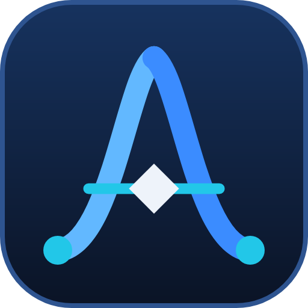
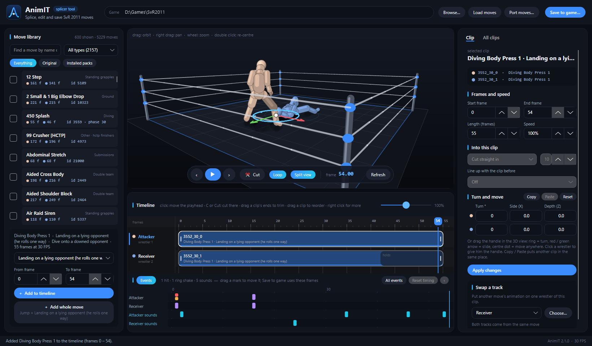
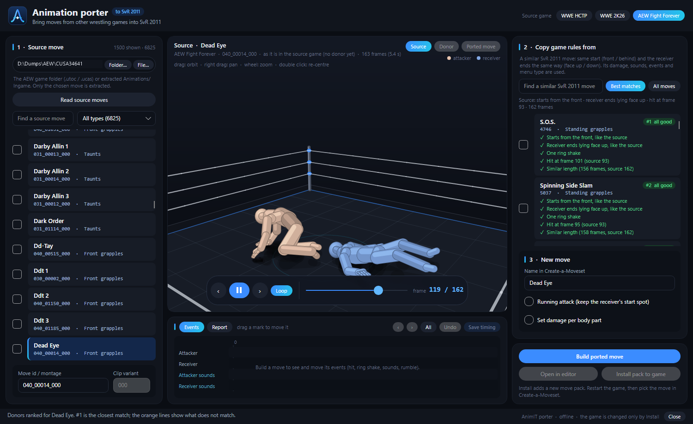

  

<h1 align="center">AnimIT</h1>

  <b>Splice, edit and save moves for WWE SmackDown vs. Raw 2011 (PC port) — and port moves from 
  WWE SmackDown! Here Comes the Pain, WWE 2K26 and AEW Fight Forever.</b>

  <a href="../../releases/latest">Download</a> ·
  <a href="docs/USER_GUIDE.md">User guide</a> ·
  <a href="docs/PORTING_GUIDE.md">Porting guide (HCTP / 2K26 / AEW)</a> ·
  <a href="docs/BUILDING.md">Build from source</a>

## What AnimIT does

- **Move library** — every move of your SvR 2011 game (and of installed move packs), with search and move types,
  played on a 3D ring.
- **Splicer** — put parts of different moves on a timeline, trim them, change their speed, cut them, line them up
  and join them smoothly. Moves are shown by their real parts (*Jump*, *Landing on a lying opponent*, *Hit*,
  *Hold*…), and **Add whole move** adds all the parts the game plays, in order.
- **Events** — see and move the hits, ring shakes, rumbles and sounds of your spliced move.
- **Split view** — keep your timeline on the left and preview another move on the right.
- **Save to game** — your timeline becomes a new move in the game (a move pack). You choose what kind of move it
  is (grapple, strike, dive…) and which game move it copies its rules from.
- **Animation porter** — bring moves from **HCTP** (PS2), **WWE 2K26** (PC) and **AEW Fight Forever** (PS4) into
  SvR 2011. AnimIT ranks the best SvR 2011 "donor" moves for you, previews the result in 3D and installs it as a
  pack.

## What you need

- **Windows 10 or 11, 64-bit.**
- **The WWE SmackDown vs. Raw 2011 PC port** with move-pack support (a game folder with a `Mods\Moves` folder;
  version 2.x). AnimIT only reads the game; it changes the game only when you **save** or **install** a move, and
  then only by adding a pack under `Mods\Moves`.
- For porting: your own copy of the source game — see the [porting guide](docs/PORTING_GUIDE.md).

Nothing else to install: the release download includes the .NET runtime and a small Python (for the porter).

## Quick start

1. Download the latest release zip from the [Releases page](../../releases/latest) and unzip it anywhere
   (for example `C:\Tools\AnimIT`). Keep all files together.
2. Start `AnimIT.exe`.
3. Click **Browse…**, choose your SvR 2011 game folder, then **Load moves**.
4. Pick a move in the library, choose its part, and click **Add to timeline** (or **Add whole move**).
5. Add more clips, adjust them, then click **Save to game…**.
6. **Restart the game** and find your move in Create-a-Moveset, in the list the Save window told you.

To port a move from another game, click **Port moves…** — see the [porting guide](docs/PORTING_GUIDE.md).

> **Tip:** test new moves on a copy of your game folder first. Every save keeps the previous `pack.txt` as
> `pack.txt.bak`, and every ported move is its own pack you can delete.

## Documentation

- [User guide](docs/USER_GUIDE.md) — the editor, step by step
- [Porting guide](docs/PORTING_GUIDE.md) — HCTP, WWE 2K26 and AEW Fight Forever: what you need and how to port
- [Building from source](docs/BUILDING.md)
- [Changelog](CHANGELOG.md)

## Credits and license

AnimIT is made by **SUL** ([MrSUL](https://github.com/isMrSUL)).

It is free and open source under the [MIT License](LICENSE): you may use it, change it and share your own
versions — just keep the copyright notice and **credit the original work (AnimIT by SUL)**.
Third-party components and their licenses are listed in [THIRD-PARTY-NOTICES.md](THIRD-PARTY-NOTICES.md).

AnimIT is a free fan-made modding tool. It contains no game files and is not affiliated with or endorsed by WWE,
Yuke's, THQ, 2K, AEW or THQ Nordic. All trademarks belong to their owners.
