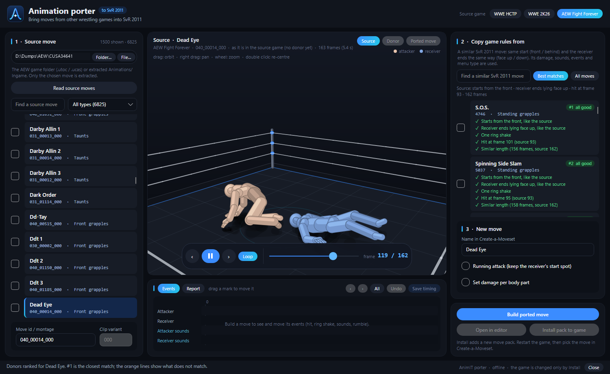

# Porting guide: HCTP, WWE 2K26 and AEW Fight Forever → SvR 2011

AnimIT's **animation porter** takes a move animation from another wrestling game, fits it to SvR 2011's skeleton,
and saves it as a new SvR 2011 move. Open it from the main window with **Port moves…** (load your SvR 2011 game
first — the porter uses its skeleton and moves).

## How porting works (read this once)

An SvR 2011 move is more than an animation: it also needs a **move record** — which Create-a-Moveset list it is
in, how the game starts it (from the front, from behind, running, in the corner…), its damage, sounds, hit
timing and how the opponent ends up. The porter gets all of this from a **donor**: a similar SvR 2011 move.

So every port is: **source animation** (from the other game) + **donor** (an SvR 2011 move) = **new move**.

A good donor:
- **starts the same way** (front / behind / running / corner / ground / dive), and
- **ends the same way** for the opponent (standing, or lying **face up** / **face down**) — the game continues
  from the donor's ending, so a wrong ending makes the opponent flip or snap.

You don't have to find it yourself: after you pick a source move, **Best matches** ranks every SvR 2011 move and
marks what fits (✓) and what doesn't (⚠). For HCTP you can also leave the donor on **Choose automatically**.

## The three steps (all sources)

1. **Source move** (left)
   1. Choose the source game at the top right: **WWE HCTP**, **WWE 2K26** or **AEW Fight Forever**.
   2. Choose its files with **Folder…** or **File…** (what to choose is explained per game below).
   3. Click **Read source moves**, then search and pick a move. It plays in the 3D view as it is in the source
      game (**Source** button). AEW moves have a type filter (front grapples, strikes, dives, taunts…).
2. **Copy game rules from** (right, top) — pick the **donor**. **Best matches** shows the ranking; **All moves**
   shows every SvR 2011 move. The **Donor** button plays the donor.
3. **New move** — type its name in Create-a-Moveset. Options:
   - **Running attack (keep the receiver's start spot)** for running moves.
   - **Set damage per body part** (head / body / arms / legs) — otherwise the donor's damage is used.

Then:

- **Build ported move** — converts the animation and checks the result. The **Ported move** button plays it, and
  the **Report** tab lists what was done. The game is not changed.
- **Events** (bottom) — the new move's hits, ring shakes, rumbles and sounds. Drag a mark to move it, then
  **Save timing**. For AEW, the events are already placed on AEW's own markers (dashed lines); **Match AEW**
  does it again.
- **Open in editor** — opens the built move in the AnimIT editor (to splice it with other moves or save it with
  **Save to game…**).
- **Install pack to game** — **close the game first.** Adds the move as a new pack under `Mods\Moves`. Restart
  the game and find the move in Create-a-Moveset (in the donor's list).

Builds are kept outside the game in `%LOCALAPPDATA%\AnimIT\PortedMoves` (logs in its `jobs` folder). Every
installed move is its own pack in `Mods\Moves`, so you can remove one by deleting its folder.

---

## WWE SmackDown! Here Comes the Pain (PS2)

**What you need:** your own copy of the **HCTP disc** (PS2), copied to a folder.

1. Copy **all files of the disc** to a folder, for example `D:\HCTP`. From a disc image (`.iso`): in Windows
   right-click → **Mount** and copy everything, or open it with 7-Zip and extract it.
2. The folder must contain **`PAC\M.PAC`** and **`PAC\MOVES.PAC`**.
3. In the porter choose **WWE HCTP**, click **Folder…** and choose that folder (`D:\HCTP`).
4. **Read source moves** — HCTP moves are listed with their real names.

Tips:
- HCTP is the closest game to SvR 2011, so most moves convert very cleanly, and the donor can be left on
  **Choose automatically**.
- Tested with the European (PAL) disc. Other regions should have the same layout.
- HCTP moves preview in 3D only after **Build** (the source preview is for 2K26 and AEW).

---

## WWE 2K26 (PC)

**What you need:** your own **WWE 2K26 for PC** installation (Steam).

**Option A — the game folder (easiest):**
1. In the porter choose **WWE 2K26**, click **Folder…** and choose your 2K26 game folder, usually
   `C:\Program Files (x86)\Steam\steamapps\common\WWE 2K26`.
2. **Read source moves.** The first time, AnimIT extracts the game's animation banks from its `.cak` archives into
   a cache (`%LOCALAPPDATA%\AnimIT\PortedMoves\sources`). This can take a while; later reads are fast.

**Option B — already extracted files:** choose a folder (or a file) of extracted **`.clips`** banks or single
**`.clip`** files. For a paired move, include both wrestlers' clips.

What you need to know:
- Reading `.cak` archives needs **`oo2core_9_win64.dll`** (Oodle). It is **not** included with AnimIT — it comes
  with WWE 2K26 itself. AnimIT finds it in your 2K26 folder automatically. If it says it is missing, copy it from
  the 2K26 game folder into `AnimIT\Porter\cake`.
- 2K26 moves are listed **by number** ("2K26 move 1234"), not by name. Use the 3D source preview to find the move
  you want. The **Clip variant** box (000–100) picks a version of the move.

---

## AEW Fight Forever (PS4)

**What you need:** your own **AEW Fight Forever PS4** game as an **unencrypted dump** (the folder named
`CUSA34641`).

1. In the porter choose **AEW Fight Forever**, click **Folder…** and choose the `CUSA34641` folder.
   AnimIT reads the game's `.utoc` / `.ucas` archives directly and extracts only the move you build.
   (It also uses the dump's own `oo2core_9_win64.dll`.)
2. Alternatively, choose an already extracted **`Animations\Ingame`** folder.
3. **Read source moves.** Moves are listed with names from the game's tables (or from the file name when the game
   has none) and a type — use the type filter next to the search.

What you need to know:
- The Steam (PC) version's archives are encrypted, so AnimIT cannot read them directly. Extracted
  `Animations\Ingame` folders may work, but only the PS4 dump has been tested.
- **Dives:** AEW splits a dive into a **jump** piece and **landing** pieces (standing / lying face up / face down).
  The list names each piece, for example *Coffin Drop (jump from the top rope)*. Pick any piece: AnimIT builds the
  whole dive — AEW's jump plus AEW's landings — on an SvR 2011 dive donor. Best matches only offers dives for
  dives, and warns when a donor can't hit a lying opponent.
- Hit, ring-shake and rumble timing is taken from AEW's own markers.

---

## Testing your ported move

1. **Close the game**, click **Install pack to game**, then start the game.
2. Give the move to a wrestler in Create-a-Moveset (it is in the donor's list).
3. **Test it in a match** — the Create-a-Moveset preview only uses part of the game's animation data, and some
   ported dives cut in the preview while they play fully in a match.

If something looks wrong:

| Problem | Try |
|---|---|
| The opponent flips or snaps at the end | A donor whose receiver ends the same way (face up / face down / standing) |
| The move starts from the wrong spot | A donor that starts the same way; for running moves tick **Running attack** |
| The hit / sound / shake is early or late | Move it in **Events** and **Save timing** before installing |
| A dive misses a lying opponent | A dive donor that has a landing on a lying opponent |
| The move is not in Create-a-Moveset | Restart the game; look in the **donor's** list |

## Safety

- The porter **never** changes your source games; it only reads them.
- Your SvR 2011 game changes only when you click **Install pack to game**, and then only by adding a new pack
  folder under `Mods\Moves`.
- Test on a copy of your game folder if you want to be extra safe.
