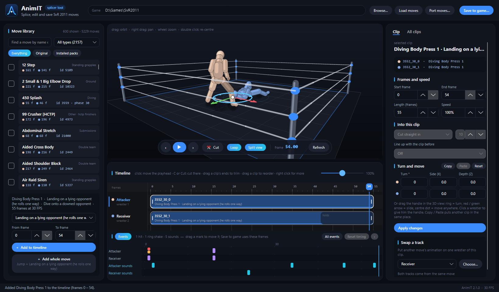

# AnimIT user guide

This guide explains the AnimIT editor (the main window). To bring moves from other games, see the
[porting guide](PORTING_GUIDE.md).

## 1. Open your game

1. Click **Browse…** and choose your **SvR 2011 PC port** folder (the folder with `svr2011.exe`, `pac` and `Mods`).
2. Click **Load moves**. AnimIT reads the game's moves and every installed move pack. Nothing is changed.

AnimIT remembers the folder for next time.

## 2. The move library (left)

- **Search** by name or move id, and filter by **type** (standing grapples, strikes, diving, corner…).
- **Everything / Original / Installed packs**: all moves, only the game's own moves, or only moves from packs.
- Each row shows the move's name, type, id and frame counts (● attacker, ● receiver).
- Check the boxes and **right-click** to copy the names or ids of the checked moves.

Click a move to play it on the 3D ring.

### Parts of a move

Many SvR moves are made of several **parts** (the game calls them phases). Below the library you choose the part:

| Move | Parts |
|---|---|
| Dives | **Jump**, **Landing on a lying opponent** (two versions: he rolls one way / the other way), **Landing on a standing opponent**, **Miss** |
| Running, corner and some strikes | **Approach (before the hit)**, **Hit** / **Corner hit** |
| Submission holds | **Put on the hold**, **Hold (loops)**, **Let go of the hold** |
| Most grapples | **Main move** (sometimes also an *Alternative version*) |

Each part also shows who is in it (*attacker alone* or *both*) and its length. Empty 1-frame parts are hidden.

- **From frame / To frame**: use only a piece of the part.
- **Add to timeline**: adds the chosen part.
- **Add whole move**: adds every part the game plays for this move, one after the other (for a dive: jump +
  landing; for a corner attack: approach + hit; for a hold: put on + hold + let go). The button shows what it will
  add.

## 3. The 3D view and the timeline (middle)

**3D view:** drag to orbit, right-drag to pan, mouse wheel to zoom, double-click to re-centre.

**Transport:** play / pause, step one frame (‹ ›), **Cut**, **Loop**, **Split view**, **Refresh**.

**Timeline:**
- Click to move the playhead.
- **C** or **Cut**: cut the clip under the playhead in two (both halves stay exactly in place).
- Drag a clip's ends to trim it; drag a clip to reorder it.
- Right-click a clip or a lane for more options.

**Split view:** when the timeline has clips, clicking a move in the library plays it on the **right side**, next to
your timeline (left side). Close it with **✕**, or turn it off with **Split view**.

### Events

Under the timeline, the **Events** strip shows what the saved move will do and when:

- **Attacker / Receiver** lanes: hits (damage), ring shakes, controller rumbles; **All events** also shows the small
  ones (grabs, states, positions).
- **Attacker sounds / Receiver sounds** lanes.

Drag a mark to move it (or select it and use **‹**). **Reset timing** puts every event back where its clip had it.
**Save to game** writes the events at the frames you set.

## 4. The selected clip (right)

Click a clip on the timeline to edit it in the **Clip** tab:

- **Frames and speed**: start / end frame, length, speed (100% = normal).
- **Into this clip** — how this clip joins the clip before it:
  - **Smooth (keeps moving)** — recommended: the new clip plays from its first frame and the jump between the
    clips fades away over the number of frames you set, so the wrestlers keep moving through the cut.
  - **Blend in (old pose fades)** — the last pose of the clip before fades into this clip.
  - **Cut straight in** — no blending.
- **Line up with the clip before** — moves and turns this clip so it continues where the clip before ended:
  - **Auto (keeps a downed receiver in place)** — usually the best choice.
  - **Keep the attacker where he is** / **Keep the receiver where he is** — line up by one wrestler only.
  - **Continue the clip before (after a cut)** — the second half of a cut clip.
  - **Off** — the clip plays where it was made.
  - A move's own **approach + hit** are lined up automatically by the receiver, like in the game.
- **Turn and move** — turn or slide each wrestler for this clip, or drag the handle in the 3D view (ring = turn,
  red / green arrow = slide, centre dot = move anywhere; click a wrestler to give him the handle).
  **Copy / Paste** puts another clip in the same place; **Reset** clears it.
- **Swap a track** — put another move's animation on one wrestler of this clip (**Attacker** or **Receiver**, then
  **Choose…**).
- A strike with no receiver track: the game plays one of its own hit reactions when it lands. AnimIT shows one in
  the preview (the game still picks it).

Click **Apply changes** after editing. The **All clips** tab lists every clip (reorder with ↑ ↓, **Remove**).

## 5. Save to game

Click **Save to game…**:

1. **Move name** — the name shown in Create-a-Moveset. Saving the same name again replaces that move.
2. **What kind of move is it?** — the list it goes into (standing grapples, strikes, running, diving, ground…).
3. **Donor** — the game move whose rules the new move copies: its list, damage, match records and how the game
   starts it. It starts on your first clip's move; search to choose another. The window tells you which
   Create-a-Moveset list the move will be in, and which parts of the donor the game still plays around your
   animation (for example a strike's approach).

The move is saved as a pack in `Mods\Moves\animit_moves` (the old `pack.txt` is kept as `pack.txt.bak`).
**Restart the game**, then give the move to a wrestler in Create-a-Moveset and try it in a match.

### Good to know

- **Test in a match.** Create-a-Moveset previews only show part of the game's animation data. Most moves preview
  fine, but some ported or spliced dives cut in the preview and still play fully in a match.
- **Hidden donors:** some game moves are hidden from the lists. If you choose one as donor, AnimIT makes the new
  move visible and also gives it a preview copy.
- **Taunts** can be previewed and spliced, but not saved yet (the game plays taunts in another format).
- Work on a **copy of your game folder** while you learn — it is the easiest way to undo everything.
